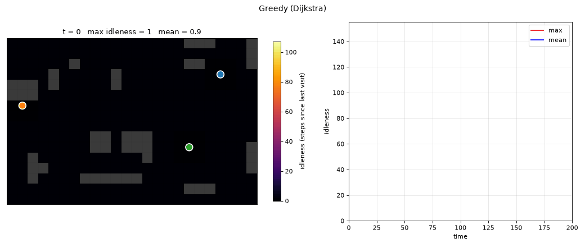
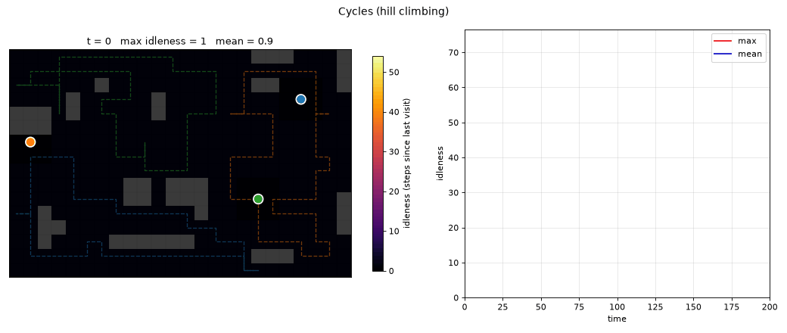

# Drone patrol: persistent coverage of a surveillance area

Project for the *Modeling and Problem Solving* course (M2, Université Paris-Dauphine - PSL).

N drones continuously monitor a grid with obstacles. Each cell must be *revisited* regularly so that no area stays blind for too long. The goal is to minimize the maximum idleness (time since a cell was last observed) in steady state.

The project compares two families of heuristic search methods:

- **Reactive / MAPF**: at each step, each drone picks a target and the moves are coordinated without collision.
- **Global optimization**: patrol cycles are precomputed and optimized, which *bounds* the idleness.

Optimized cycles divide the worst idleness by about 2.5 compared with the best reactive strategy. The full analysis is in the [report](report/report.pdf).

| Greedy baseline | Optimized cycles (hill climbing) |
|---|---|
|  |  |

## Results

Steady-state idleness on a 24x16 grid, 12% obstacles, 3 drones, seed 42, 400 steps (lower is better).

| Family | Strategy | Max idleness | Mean idleness |
|---|---|---|---|
| Reactive | Greedy (Dijkstra) | 135.8 | 52.1 |
| Reactive | Space-time A* | 161.4 | 65.3 |
| Reactive | Conflict-Based Search | 138.4 | 49.2 |
| Reactive | Partial Move A* | 190.7 | 73.3 |
| Cycles | **Hill climbing** | **53.7** | **22.7** |
| Cycles | Genetic algorithm | 57.2 | 23.9 |

## Installation

```bash
python3 -m venv .venv
source .venv/bin/activate
pip install -r requirements.txt
```

## Usage

```bash
python main.py demo --strategy greedy          # animate a strategy (see the list below)
python main.py compare --steps 400             # compare several strategies
python main.py optimize --budget 6000          # convergence of hill climbing, GA and NRPA
python generate_figures.py                     # regenerate the report figures
```

Options: `--width --height --drones --obstacles --radius --seed`, `--no-show`, `demo --save out.gif`, `--heuristic manhattan|alt`.

## Algorithms

| `--strategy` | File(s) | Algorithm |
|---|---|---|
| - | `environment.py` | Problem model (grid, sensors, idleness) |
| `greedy` | `strategies/greedy.py` | Dijkstra, greedy target choice |
| `astar` | `strategies/astar_patrol.py` | Space-time A* with prioritized planning (Silver 2005) |
| (`--heuristic alt`) | `algorithms/alt.py` | ALT: landmarks and triangle inequality |
| `cbs` | `strategies/cbs_patrol.py` | Conflict-Based Search |
| `pma` | `strategies/pma_patrol.py` | Partial Move A* (joint search) |
| `hill` | `optimization/hill_climbing.py` | Hill climbing on the multi-TSP |
| `ga` | `optimization/genetic.py` | Genetic algorithm |
| `nrpa` | `optimization/nrpa.py` | NRPA (Nested Rollout Policy Adaptation) |

## Structure

```
environment.py           grid, obstacles, idleness
algorithms/              Dijkstra, A*, ALT, CBS, PMA*
strategies/              one patrol strategy per algorithm
optimization/            waypoints (multi-TSP), hill climbing, GA, NRPA
simulation.py            simulation loop and metrics
visualization.py         animations and plots
main.py                  command-line entry point
generate_figures.py      report figures
report/                  LaTeX report, figures and PDF
outputs/                 example animations and plots
```

## Authors

Emile Descroix, Anaël Ernadote.
